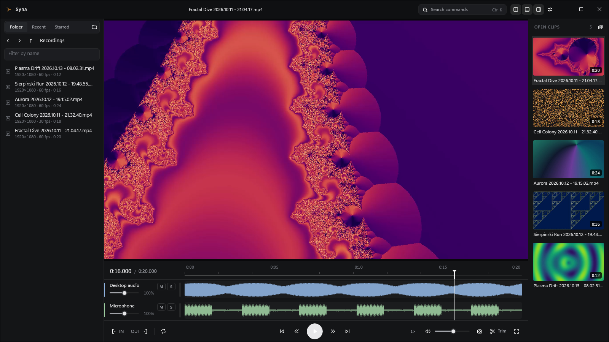
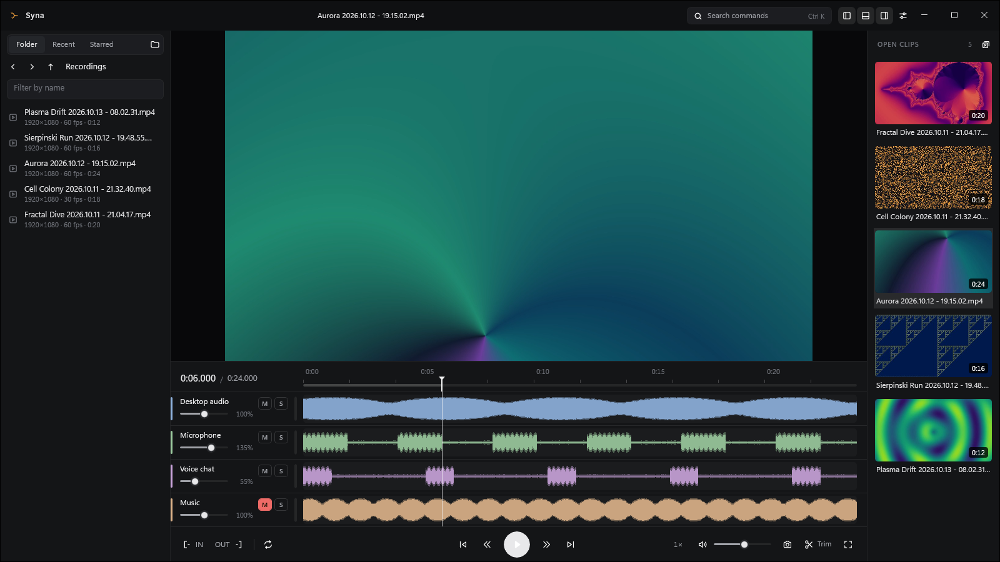
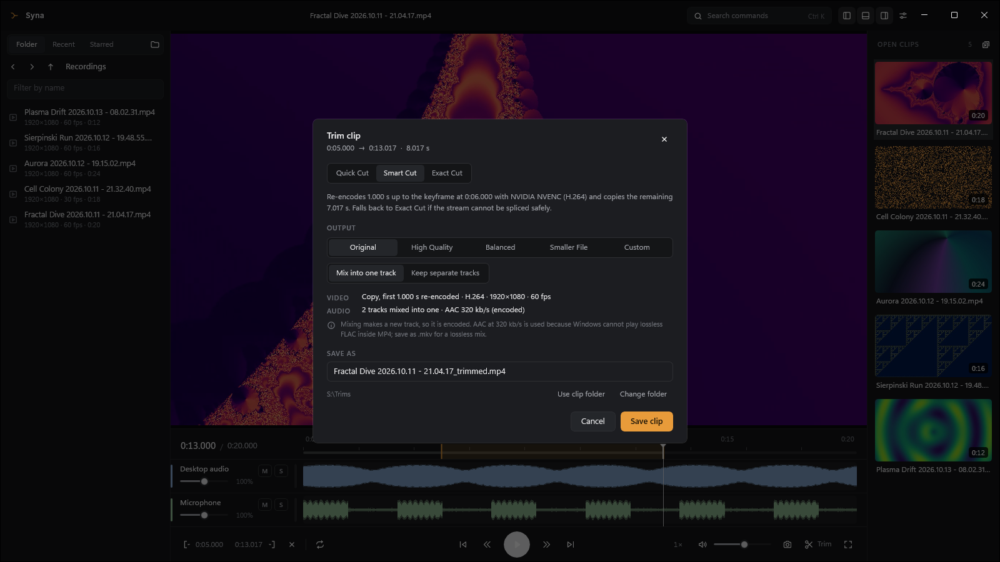
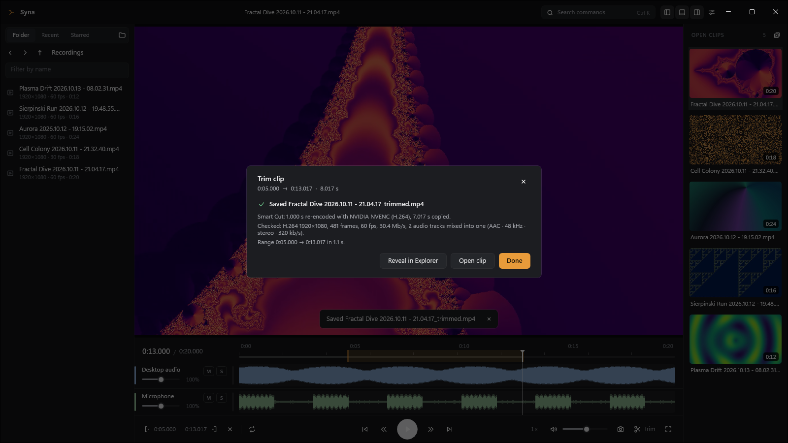
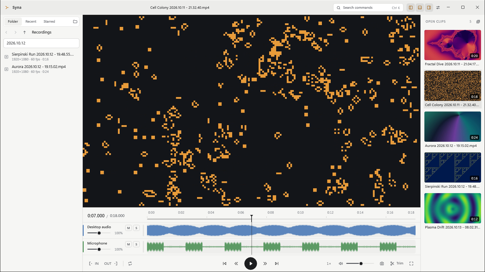
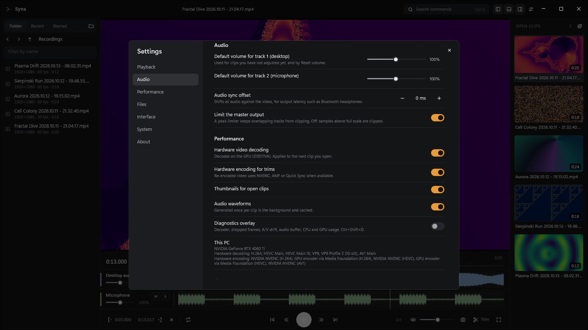

<p align="center">
  
</p>

<h1 align="center">Syna</h1>

<p align="center">
  A Windows player and trimmer for gameplay recordings, with every audio track under its own control.
</p>

<p align="center">
  <a href="../../releases/latest"><b>Download</b></a> ·
  <a href="#install">Install</a> ·
  <a href="#trimming">Trimming</a> ·
  <a href="docs/BUILDING.md">Build from source</a>
</p>

<p align="center">
  <a href="LICENSE"></a>
  
  <a href="../../actions/workflows/ci.yml"></a>
</p>



## Why

Game recorders such as NVIDIA's ShadowPlay save high-bitrate H.264 or HEVC clips with the game sound
and the microphone as separate audio tracks. Going through them is slow with general tools. Many
players and sites play only the first track. Editors take a while to open for a ten-second cut, and
re-encoding a cut costs time and quality.

Syna opens a clip with hardware decoding and gives every audio track its own volume, mute, solo and
timing. It cuts a selection without re-encoding wherever the video allows, and says beforehand what
will be copied and what re-encoded. The source file is never modified.

## Features

**Playback**
- Hardware decoding through Direct3D 11 (D3D11VA) with zero-copy rendering; software decoding as a
  fallback, shown as such. H.264, HEVC (8- and 10-bit), AV1, VP9 and other codecs FFmpeg decodes, in
  MP4, MOV, MKV and WebM.
- The audio clock drives the picture. Measured A/V drift is about 3 ms, and 1080p60 plays without
  dropped frames ([PERFORMANCE.md](docs/PERFORMANCE.md)). Variable frame rate recordings play and
  step on their real timestamps.
- Exact seeking, frame stepping in both directions, J/K/L, 1 s and 5 s skips (configurable), speeds
  from 0.25× to 2× with pitch kept, loop and A–B loop, fullscreen, HDR (PQ/HLG) tone mapped to SDR.

**Audio tracks**
- Each track has its own gain (up to +6 dB), mute, solo and timing offset, a peak meter and a
  waveform lane. A master volume and an optional peak limiter sit on top.
- Track names come from the file ("Desktop audio", "Microphone"), can be renamed, and are remembered
  per clip together with the mix.
- Recorder timestamp jitter is absorbed without dropping or inserting samples, so tracks do not pop
  or stutter ([MEDIA_ENGINE.md](docs/MEDIA_ENGINE.md#placing-decoded-audio-on-the-timeline)).

**Trimming**
- Quick Cut, Smart Cut and Exact Cut, from a bit-identical copy to a frame-accurate re-encode
  ([details below](#trimming)).
- Audio mixed into one track or kept as separate tracks, each as the mixer plays it.
- Output profiles from Original (copy whenever the cut allows) to Smaller File, plus Custom (codec,
  size, frame rate, quality or bitrate, encoder speed, lossless video, audio format).

**Clips and library**
- Several clips open at once in a list with thumbnails. Positions are remembered, and the open clips
  can be restored at startup.
- A built-in explorer with folders, recent and starred clips, a name filter and clip details. It can
  rename, reveal in Explorer, copy the path, and move to the Recycle Bin (never a permanent delete).
  Watched folders announce new recordings.
- Snapshots of the current frame to PNG or JPEG, or to the clipboard.

**Everywhere**
- Keyboard first ([shortcuts](#keyboard)), a command palette (Ctrl+K), media info (Ctrl+I) and a
  diagnostics overlay that names the decoding path in use.
- Dark and light themes. One window: opening another clip from Explorer adds it to the running
  instance.
- "Open with" registration and a shortcut to the Windows Default apps page. Syna never changes the
  default app by itself.

## Gallery

<table>
  <tr>
    <td width="50%"></td>
    <td width="50%"></td>
  </tr>
  <tr>
    <td>Four tracks, each with its own volume, mute and solo</td>
    <td>The trim sheet says what will be copied and what re-encoded</td>
  </tr>
  <tr>
    <td></td>
    <td></td>
  </tr>
  <tr>
    <td>The report after saving, checked against the source</td>
    <td>Light theme, explorer filtered by name</td>
  </tr>
  <tr>
    <td colspan="2" align="center"></td>
  </tr>
  <tr>
    <td colspan="2" align="center">Settings, with the hardware this PC offers</td>
  </tr>
</table>

The screenshots show synthetic clips generated by
[`scripts/capture-readme-screenshots.ps1`](scripts/capture-readme-screenshots.ps1).

## Install

1. Download `Syna-Setup-<version>-x64.msi` and its `.sha256` from the
   [latest release](../../releases/latest).
2. Optionally check the download in PowerShell; the hash must equal the one in the `.sha256` file:

   ```powershell
   (Get-FileHash .\Syna-Setup-1.0.0-x64.msi -Algorithm SHA256).Hash
   ```

3. Run the installer. It installs Syna for your user account into `%LOCALAPPDATA%\Programs\Syna`,
   adds a Start menu entry and lists Syna in "Open with" for `.mp4 .m4v .mov .mkv .webm`. It needs
   no administrator rights and no other downloads.

The installer is not code-signed yet. Windows SmartScreen may show "Windows protected your PC"; choose
*More info*, then *Run anyway*. The checksum above tells you whether the file is the one the release
published.

To make Syna the default player, choose it in Windows Settings > Apps > Default apps (Syna's settings
have a button that opens that page). A newer installer upgrades in place. Uninstall from Settings >
Apps; your settings and history in `%LOCALAPPDATA%\Syna` stay unless you delete that folder. Details:
[PACKAGING.md](docs/PACKAGING.md).

## Requirements

- Windows 11, x64. That is what Syna is developed and tested on. The build targets Windows 10 version
  2004 and later too, but Windows 10 has not been tested.
- A Direct3D 11 GPU. Hardware decoding uses D3D11VA, and hardware encoding for trims uses NVENC, AMF
  or Quick Sync where the driver offers them. Tested with an NVIDIA GeForce RTX 4060 Ti; AMD and
  Intel GPUs go through the same paths but have not been tested. Without hardware support, Syna
  decodes and encodes on the CPU.

## Quick start

1. Open clips by double-clicking them in Explorer, dragging them onto the window, or with Ctrl+O. The
   explorer on the left browses folders; the list on the right holds the open clips.
2. Play with Space or J/K/L, step with ← and →, and set the track volumes in the lanes under the
   video.
3. Mark the part to keep with I and O, press Ctrl+T, choose a mode, then *Save clip*. The trim goes to
   the folder shown in the sheet, next to the source by default.

## Trimming

| Mode | Video | Starts at | Re-encoded |
|---|---|---|---|
| Quick Cut | copied | the keyframe at or before IN, so it may start early | nothing: the video is the source's bitstream |
| Smart Cut | re-encoded from IN up to the first IDR frame in the selection, copied from there | the frame containing IN | at most one GOP |
| Exact Cut | re-encoded | the frame containing IN | the whole selection |

- **End.** Exact Cut ends with the last frame displayed before OUT. A copied stream ends with the last
  packet needed for the frames before OUT; with B-frames that can include a frame or two after OUT.
- **Fallbacks.** Smart Cut splices H.264, and HEVC when the encoder's parameter sets match the
  source's. Other codecs, and splices that would not be standards-compliant, fall back to Exact Cut,
  and the report says why.
- **Speed.** On a real 1080p60 recording (RTX 4060 Ti), a 15 s Smart Cut takes about 1 s and an Exact
  Cut about 4 s ([PERFORMANCE.md](docs/PERFORMANCE.md#trimming)).
- **Audio.** Several tracks are mixed into one, or kept separate, at the volume, mute, solo and offset
  the mixer gives each. The master volume is a listening level and is not applied. Separate tracks
  the mixer leaves alone are copied bit for bit. The video is never re-encoded for the audio's sake.
- **Profiles.** Original copies whatever the mode allows and re-encodes only what it must, keeping
  the source's codec, size and frame timing. High Quality, Balanced and Smaller File re-encode the
  whole selection, so every mode cuts frame-accurately with them. Custom chooses each setting, and
  lossless video where an encoder really has a lossless mode; the engine checks the pixels.
- **Safety.** The source is never modified. The output is written to a temporary file, reopened,
  decoded and checked, then moved into place under a name that does not overwrite anything.

The full rules, guarantees and report format are in [TRIM.md](docs/TRIM.md).

## Keyboard

| Keys | Action |
|---|---|
| Space | Play / pause |
| J / K / L | Slower (or back 1 s when paused) / pause / play, then faster |
| ← / → | Previous / next frame |
| Shift+← / Shift+→ | Skip 1 s (configurable) |
| Ctrl+← / Ctrl+→ | Skip 5 s (configurable) |
| Home / End | First / last frame |
| [ / ] / Backspace | Slower / faster / normal speed |
| I / O | Set IN / OUT (with Shift: go to IN / OUT) |
| Ctrl+Shift+X | Clear the selection |
| R | Loop the selection |
| Ctrl+T | Trim |
| M, ↑ / ↓ | Mute, volume |
| Alt+1…8 / Alt+Shift+1…8 | Mute / solo an audio track |
| F or F11, Esc | Fullscreen, leave fullscreen |
| Ctrl+Shift+S / Ctrl+Shift+C | Save / copy the current frame |
| Ctrl+O / Ctrl+Shift+O | Open files / open a folder |
| Ctrl+Tab, Ctrl+W, Ctrl+Shift+W | Next clip, close the clip, close all clips |
| Ctrl+D | Star the clip |
| Ctrl+E, Ctrl+Alt+C | Reveal in Explorer, copy the path |
| Ctrl+K, Ctrl+I, Ctrl+, | Command palette, media info, settings |
| Ctrl+Shift+E / A / L | Show or hide the explorer, the audio tracks, the clip list |
| Ctrl+Shift+D | Diagnostics overlay |

## How it is built

A WinUI 3 app in C# (.NET 10) on top of a C++20 engine that talks to it through a small C ABI:

- **Engine** (`src/Syna.Native`): FFmpeg 8.1 for demuxing, decoding and encoding; Direct3D 11
  for decoding (D3D11VA) and presentation; WASAPI for audio output and the master clock; a mixer with
  per-track gain, offset and limiter; and the trim engine.
- **Core** (`src/Syna.Core`): engine interop, settings and state (SQLite), and the trim planner that
  predicts what a trim will do.
- **App** (`src/Syna.App`): the window, the views and the Windows integration (single instance, file
  activation, "Open with").

More in [ARCHITECTURE.md](docs/ARCHITECTURE.md), [MEDIA_ENGINE.md](docs/MEDIA_ENGINE.md) and
[DECISIONS.md](docs/DECISIONS.md).

## Build from source

With Visual Studio 2026 (C++ desktop workload) and the .NET 10 SDK, from the repository root:

```powershell
.\scripts\build.ps1 -Configuration Release
.\scripts\test.ps1
.\scripts\package.ps1 -Configuration Release
```

[BUILDING.md](docs/BUILDING.md) covers requirements, every script, tests and the pinned FFmpeg
download. [RELEASING.md](docs/RELEASING.md) describes how releases are built and published.

## Documentation

| | |
|---|---|
| [ARCHITECTURE.md](docs/ARCHITECTURE.md) | Layers, threads, state, data on disk |
| [MEDIA_ENGINE.md](docs/MEDIA_ENGINE.md) | Decoding, rendering, the clock, audio, probing |
| [TRIM.md](docs/TRIM.md) | Trim modes, guarantees, validation, report |
| [PERFORMANCE.md](docs/PERFORMANCE.md) | Measurements and how they were taken |
| [PACKAGING.md](docs/PACKAGING.md) | The installer, file types, upgrades, signing |
| [BUILDING.md](docs/BUILDING.md), [RELEASING.md](docs/RELEASING.md) | Building, testing, releasing |
| [TEST_MATRIX.md](docs/TEST_MATRIX.md) | What is tested, automatically and by hand |
| [DECISIONS.md](docs/DECISIONS.md), [REFERENCES.md](docs/REFERENCES.md) | Why things are built this way, and the sources |
| [FFMPEG.md](docs/FFMPEG.md) | The FFmpeg build: what Syna uses, configuration, libraries, licenses |
| [THIRD-PARTY-NOTICES.md](docs/THIRD-PARTY-NOTICES.md), [LICENSE-AUDIT.md](docs/LICENSE-AUDIT.md) | Third-party licenses, and the audit of what the installer redistributes |

## License

Syna's source code is released under the [MIT License](LICENSE), Copyright (c) 2026 hyak.

The installer also contains third-party components under their own licenses, among them FFmpeg and
the libraries built into its DLLs, the .NET runtime (MIT) and the Microsoft Windows App SDK
(Microsoft Software License Terms). [THIRD-PARTY-NOTICES.md](docs/THIRD-PARTY-NOTICES.md) lists them
with versions, license texts and FFmpeg's corresponding source; [LICENSE-AUDIT.md](docs/LICENSE-AUDIT.md)
records the audit before the first release.

## Contributing

Syna is developed by one person and is young: expect rough edges, and expect the order of
priorities to be the author's. Bug reports with a log (`%LOCALAPPDATA%\Syna\Logs`) and the clip's
media info are the most useful contribution. See [CONTRIBUTING.md](CONTRIBUTING.md), and
[SECURITY.md](SECURITY.md) for reporting vulnerabilities.

---

<p align="center">Designed &amp; engineered by hyak.</p>
